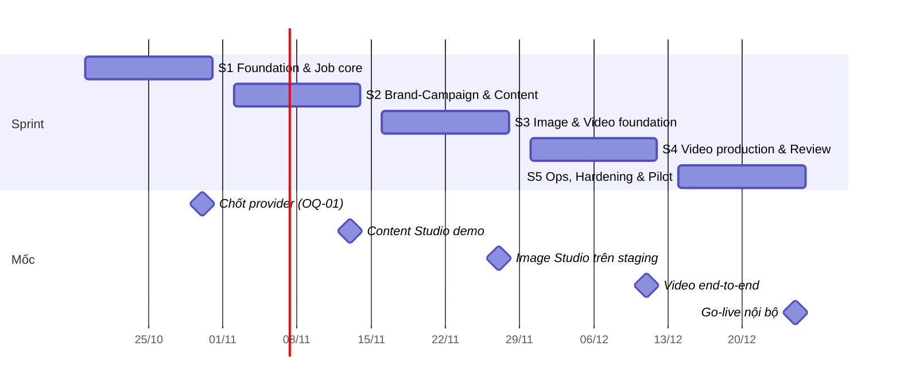
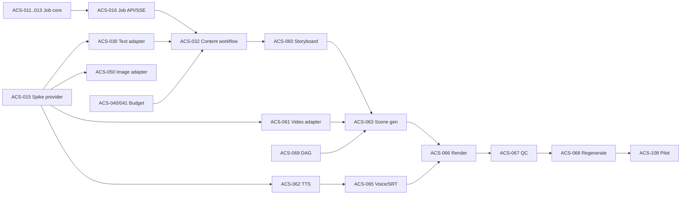

# SPRINT PLAN — AI Content Studio MVP

## 1. Giả định & năng lực

| Hạng mục             | Giá trị                                                                                               |
| -------------------- | ----------------------------------------------------------------------------------------------------- |
| Team                 | 2 dev full-time (1 BE-lean, 1 FE/fullstack) + TL part-time (spike, review, security) + 1 PO/Marketing |
| Sprint               | 2 tuần (10 ngày làm việc)                                                                             |
| Capacity             | 2 dev × 10 ngày × 0.9 focus ≈ **18 dev-day/sprint**                                                   |
| Ước lượng            | Dev-day lý tưởng, có dùng AI coding assistant (xem [tasks/BACKLOG.md](../tasks/BACKLOG.md))           |
| Tổng backlog         | **88.5 dev-day** / 80 task                                                                            |
| Ngày bắt đầu đề xuất | Thứ Hai 19/10/2026                                                                                    |

### Vì sao 5 sprint (10 tuần) thay vì 8 tuần như PRD

PRD ghi 8 tuần là _kế hoạch tham chiếu, không phải cam kết_. Khi bóc tách đủ task (bao gồm hardening, backup drill, E2E, pilot), tổng ≈ 88.5 dev-day so với capacity 8 tuần ≈ 72 dev-day → thiếu ~16 ngày. Hai lựa chọn:

| Phương án                               | Cách làm                                                                                                                              | Rủi ro                                                |
| --------------------------------------- | ------------------------------------------------------------------------------------------------------------------------------------- | ----------------------------------------------------- |
| **A (khuyến nghị)**: 5 sprint / 10 tuần | Giữ đủ phạm vi P0, S5 có ~5.5 ngày buffer cho bug pilot                                                                               | Go-live muộn 2 tuần                                   |
| B: 4 sprint / 8 tuần                    | Thêm 1 FE từ S2 (capacity ~27/sprint), hoặc cắt P1 (ACS-038, ACS-085) + dời ACS-037 content plan, ACS-091/094 UI ops sang sau go-live | Không có buffer; video provider trục trặc là trễ ngay |

Kế hoạch dưới đây theo **phương án A**.

## 2. Lộ trình tổng

| Sprint | Thời gian     | Mục tiêu                                                                                         | Tải (d)            |
| ------ | ------------- | ------------------------------------------------------------------------------------------------ | ------------------ |
| S1     | 19/10 – 30/10 | Nền tảng Clean Architecture, design system, auth/RBAC, job orchestration, storage, chốt provider | 19.0               |
| S2     | 02/11 – 13/11 | Brand/Product/Campaign + Content Studio + budget core                                            | 19.5               |
| S3     | 16/11 – 27/11 | Image Studio hoàn chỉnh + nền tảng Video (storyboard, adapter, cảnh) + staging                   | 18.5               |
| S4     | 30/11 – 11/12 | Video render hoàn chỉnh + Review + Library + Usage/Dashboard                                     | 19.0               |
| S5     | 14/12 – 25/12 | Ops UI, bảo mật, backup, E2E, production, pilot                                                  | 12.5 (+5.5 buffer) |

---

## 3. Chi tiết từng sprint

### Sprint 1 — Foundation & Job core (19/10 – 30/10)

**Sprint goal:** Có khung Clean Architecture (BE + FE) và design system được PO duyệt, chạy được local + CI, đăng nhập/RBAC hoạt động, một "job giả" đi trọn vòng đời API → outbox → worker → DB với fake provider; chốt provider.

| Task    | Tên                                  | d   | Owner |
| ------- | ------------------------------------ | --- | ----- |
| ACS-001 | Monorepo + Docker Compose            | 1   | BE    |
| ACS-002 | CI pipeline                          | 0.5 | BE    |
| ACS-003 | Go API skeleton (Clean Architecture) | 2   | BE    |
| ACS-004 | React skeleton + design system       | 2.5 | FE    |
| ACS-005 | Migration + sqlc                     | 1   | BE    |
| ACS-006 | Authentication                       | 1.5 | BE    |
| ACS-007 | RBAC + /me                           | 1   | BE    |
| ACS-009 | Audit log service                    | 0.5 | BE    |
| ACS-010 | Login + auth guard                   | 1   | FE    |
| ACS-011 | Job data model                       | 1   | BE    |
| ACS-012 | Outbox + dispatcher                  | 1   | BE    |
| ACS-013 | Worker runtime                       | 2   | BE    |
| ACS-014 | Provider interfaces + fakes          | 1   | BE    |
| ACS-015 | Spike provider (timebox)             | 1.5 | TL    |
| ACS-024 | Storage service                      | 1.5 | BE    |

> Tải BE nặng hơn FE ở sprint này → dev FE nhận ACS-024 hoặc viết test cho ACS-013. ACS-020 (Brand API) dời sang S2 để nhường chỗ cho khung kiến trúc và design system.

**Demo:** trang `/_design` (token + component theo SPEC-05) để PO duyệt style; login theo role; tạo job fake qua endpoint debug → xem trạng thái đi `queued → running → succeeded` trong DB; upload file qua presigned URL.
**Exit criteria:** CI xanh kể cả arch lint; PO duyệt design system; migrations 0001–0003, 0007–0008, 0010 xong; báo cáo spike được PO + TL ký (OQ-01, OQ-05).
**Rủi ro:** spike không tìm được video provider đạt → kích hoạt fallback "ảnh + Ken Burns + TTS" (đổi phạm vi ACS-061/063).

### Sprint 2 — Brand, Campaign & Content Studio (02/11 – 13/11)

**Sprint goal:** Marketing tạo được brand, product, campaign và sinh/sửa/revision bài viết bằng AI thật, có dự toán + giữ ngân sách.

| Task    | Tên                               | d   | Owner |
| ------- | --------------------------------- | --- | ----- |
| ACS-020 | Brand API + versioning            | 1   | BE    |
| ACS-016 | Job API + SSE + cancel/retry      | 1.5 | BE    |
| ACS-017 | Idempotency-Key                   | 0.5 | BE    |
| ACS-019 | FE job tracker                    | 1   | FE    |
| ACS-021 | Brand Studio UI                   | 1.5 | FE    |
| ACS-022 | Product API + UI                  | 1   | FS    |
| ACS-025 | Campaign API                      | 1   | BE    |
| ACS-026 | Campaign UI                       | 1.5 | FE    |
| ACS-030 | Text provider adapter             | 1   | BE    |
| ACS-031 | Prompt builder                    | 1   | BE    |
| ACS-032 | Content generation workflow       | 1.5 | BE    |
| ACS-033 | Rewrite & transform               | 1   | BE    |
| ACS-034 | Asset versions API                | 1   | BE    |
| ACS-035 | Content Studio UI                 | 2   | FE    |
| ACS-036 | Post-generation checks            | 0.5 | BE    |
| ACS-040 | Pricing + estimator               | 1   | BE    |
| ACS-041 | Budget reservation                | 1   | BE    |
| ACS-042 | Usage records                     | 0.5 | BE    |
| ACS-110 | Dữ liệu brand thật + baseline KPI | PO  | PO    |

**Demo:** Flow A (trừ review): tạo campaign → sinh 3 biến thể Facebook post → viết lại → khôi phục revision; hiển thị dự toán + chi phí thực tế.
**Exit criteria:** Content job chạy với provider thật trên local/dev; test song song reservation pass; PO đã nhập brand/product thật; OQ-03 (ngân sách) đã chốt.
**Rủi ro:** chất lượng tiếng Việt → PO review 10 output đầu, TL chỉnh prompt template trong sprint.

### Sprint 3 — Image Studio & Video foundation (16/11 – 27/11)

**Sprint goal:** Image Studio hoàn chỉnh trên staging; Video có storyboard, dự toán, sinh clip từng cảnh song song.

| Task    | Tên                            | d   | Owner |
| ------- | ------------------------------ | --- | ----- |
| ACS-106 | Staging deploy + CD            | 1   | BE    |
| ACS-018 | Reconciler + maintenance       | 1   | BE    |
| ACS-023 | Brand assets (logo, ref, nhạc) | 1   | FS    |
| ACS-043 | Concurrency cap & rate limit   | 0.5 | BE    |
| ACS-050 | Image provider adapter         | 1   | BE    |
| ACS-051 | Image generation workflow      | 1.5 | BE    |
| ACS-052 | Prompt suggestion              | 0.5 | BE    |
| ACS-053 | Image Studio UI                | 2   | FE    |
| ACS-054 | Image cost rules               | 0.5 | BE    |
| ACS-060 | Video project + storyboard job | 1.5 | BE    |
| ACS-061 | Video provider adapter         | 1.5 | BE    |
| ACS-062 | TTS adapter                    | 1   | BE    |
| ACS-063 | Scene generation step          | 1.5 | BE    |
| ACS-064 | Video estimate + budget gate   | 1   | BE    |
| ACS-069 | Video workflow DAG             | 1   | BE    |
| ACS-071 | Storyboard editor UI           | 2   | FE    |

> Sprint nặng BE: dev FE/FS nhận ACS-023, ACS-052, ACS-054 và hỗ trợ ACS-064.

**Demo:** Flow B end-to-end trên staging; tạo video 20s 9:16 → storyboard → sửa cảnh → dự toán → sinh 4–6 clip song song, 1 cảnh lỗi không ảnh hưởng cảnh khác.
**Exit criteria:** Staging chạy provider thật với ngân sách riêng; OQ-04 (nhạc), OQ-07 (giới hạn video) đã chốt.
**Rủi ro:** thời gian chờ provider video dài → test bằng fake trên CI, test thật theo lịch trên staging.

### Sprint 4 — Video production, Review & Library (30/11 – 11/12)

**Sprint goal:** Xuất được MP4 hoàn chỉnh (voice, phụ đề, nhạc), sinh lại riêng cảnh; review/approve/download; thư viện và báo cáo chi phí.

| Task    | Tên                          | d   | Owner |
| ------- | ---------------------------- | --- | ----- |
| ACS-065 | Voice-over & subtitle        | 1   | BE    |
| ACS-066 | FFmpeg render worker         | 2   | BE    |
| ACS-067 | Quality check                | 0.5 | BE    |
| ACS-068 | Regenerate scene & re-render | 1   | BE    |
| ACS-072 | Video production UI          | 1.5 | FE    |
| ACS-080 | Approval API                 | 1   | BE    |
| ACS-081 | Review queue UI              | 1.5 | FE    |
| ACS-082 | Library search API           | 1   | BE    |
| ACS-083 | Asset Library UI             | 1.5 | FE    |
| ACS-084 | Download                     | 0.5 | BE    |
| ACS-008 | User management              | 1.5 | FS    |
| ACS-037 | Content plan cho campaign    | 1   | FS    |
| ACS-044 | Budget alerts                | 1   | FS    |
| ACS-092 | Usage summary                | 1.5 | FS    |
| ACS-093 | Budget settings UI           | 0.5 | FE    |
| ACS-095 | Dashboard                    | 1   | FS    |
| ACS-104 | Observability                | 1   | BE    |

**Demo:** Flow C hoàn chỉnh: storyboard → MP4 có voice + phụ đề tiếng Việt + nhạc → sinh lại cảnh 3 → render lại → gửi duyệt → reviewer approve → Creator tải về. Dashboard + báo cáo chi phí.
**Exit criteria:** Toàn bộ checklist DoD mục Core/Content/Image/Video (SPEC-01 §7) pass trên staging.
**Cut line nếu trễ:** ACS-037 → S5; ACS-095 rút gọn còn 2 widget; ACS-092 chỉ group_by day/campaign.

### Sprint 5 — Ops, Hardening & Pilot (14/12 – 25/12)

**Sprint goal:** Sẵn sàng vận hành: bảo mật, backup đã diễn tập, E2E, production; pilot với đội Marketing.

| Task    | Tên                                   | d    | Owner   |
| ------- | ------------------------------------- | ---- | ------- |
| ACS-090 | Provider/model/pricing admin          | 1.5  | FS      |
| ACS-091 | Job monitor UI                        | 1    | FE      |
| ACS-094 | Audit log UI                          | 0.5  | FE      |
| ACS-100 | RBAC & IDOR tests                     | 1    | BE      |
| ACS-101 | Security review                       | 1    | TL      |
| ACS-102 | Secrets & key rotation                | 0.5  | BE      |
| ACS-103 | Backup & restore drill                | 0.5  | BE      |
| ACS-105 | E2E tests                             | 1.5  | FE      |
| ACS-107 | Production deploy + go-live checklist | 1    | BE      |
| ACS-108 | Pilot & stabilization                 | 2    | FS + PO |
| ACS-109 | Hướng dẫn sử dụng                     | 0.5  | PO      |
| ACS-038 | Prompt template UI (**P1**)           | 1    | FS      |
| ACS-085 | Tags & quyền sử dụng (**P1**)         | 0.5  | FS      |
| —       | **Buffer** fix bug pilot              | ~5.5 | All     |

Lịch trong sprint: tuần 1 hardening + production deploy; tuần 2 pilot (3–5 user, 10 brief thật) + fix.
**Demo / nghiệm thu:** chạy checklist DoD đầy đủ (SPEC-01 §7) trên production; báo cáo pilot so với baseline KPI.
**Exit criteria:** 0 lỗi bảo mật mức High; restore drill có biên bản; PO ký nghiệm thu MVP.

---

## 4. Phụ thuộc chính (critical path)

Critical path: **Spike provider → Video adapter → Scene generation → Render → Pilot**. Mọi trễ ở spike/video provider đẩy thẳng ngày go-live.

## 5. Nghi thức sprint

| Nghi thức           | Thời điểm         | Thời lượng                              |
| ------------------- | ----------------- | --------------------------------------- |
| Sprint planning     | Thứ Hai ngày 1    | 1.5h                                    |
| Daily               | Hằng ngày         | 15'                                     |
| Backlog refinement  | Thứ Năm tuần 1    | 1h — chốt OQ cho sprint sau             |
| Provider/cost check | Thứ Sáu hằng tuần | 15' — xem chi phí staging, lỗi provider |
| Review + demo       | Thứ Sáu tuần 2    | 1h — PO + Marketing Lead                |
| Retro               | Sau review        | 45'                                     |

## 6. Theo dõi rủi ro theo sprint

| Rủi ro                        | Sprint chịu ảnh hưởng | Dấu hiệu sớm                          | Hành động                                                     |
| ----------------------------- | --------------------- | ------------------------------------- | ------------------------------------------------------------- |
| Chưa chốt được video provider | S1 → S3               | Spike chưa có ứng viên đạt ngày 28/10 | Fallback ảnh + Ken Burns + TTS; giữ interface                 |
| Chất lượng tiếng Việt kém     | S2                    | PO chấm < 3/5 cho output              | Đổi model/prompt; thêm ví dụ mẫu từ brand                     |
| Chi phí staging vượt          | S3–S4                 | > 50% ngân sách staging giữa sprint   | Fake provider cho test tự động, giới hạn thời lượng clip test |
| Render lỗi codec/font         | S4                    | QC fail > 10%                         | Chuẩn hóa clip sớm (ACS-063), font cố định trong image        |
| Thiếu reviewer trong pilot    | S5                    | Queue > 2 ngày                        | PO chỉ định reviewer cố định                                  |
| Tải BE quá cao so với FE      | S1, S3                | Burndown BE lệch                      | FE/FS nhận task BE nhẹ (đã ghi chú từng sprint)               |
| Tải BE quá cao so với FE      | S1, S3                | Burndown BE lệch                      | FE/FS nhận task BE nhẹ (đã ghi chú từng sprint)               |
