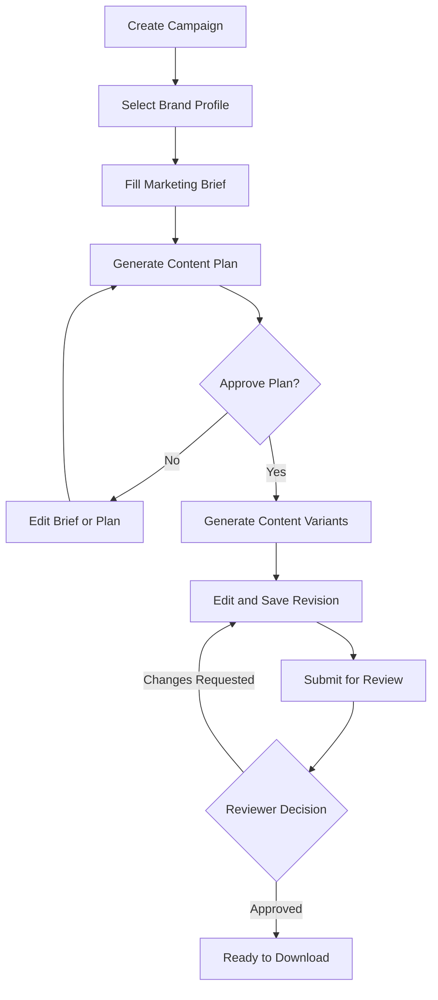
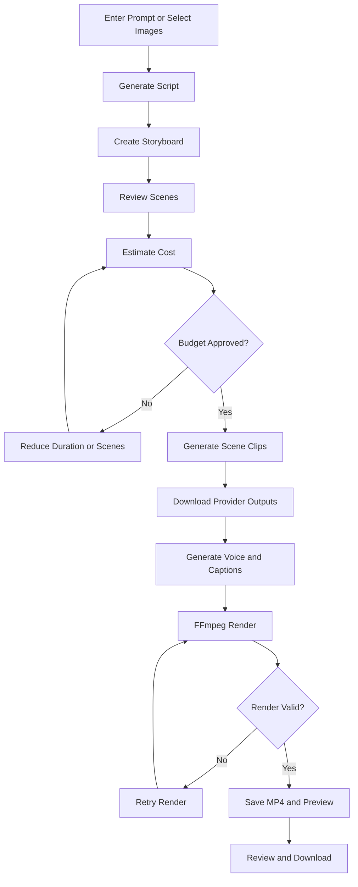

# SPEC-01 — Product Specification: AI Content Studio (MVP)

| | |
|---|---|
| Phiên bản | 1.0 (chuyển từ PRD v1.0) |
| Mô hình | Internal tool, 1 workspace |
| Người dùng | Đội Marketing |
| Đầu ra | Text · Image · Video (MP4) |
| Xuất bản | Download thủ công |

## 1. Bối cảnh & mục tiêu

### 1.1. Vấn đề
1. Nhân viên chuyển qua nhiều công cụ để viết bài, tạo ảnh, dựng video.
2. Nội dung giữa các chiến dịch thiếu đồng nhất giọng văn và nhận diện thương hiệu.
3. Không quản lý được prompt, phiên bản, file đầu ra và chi phí theo chiến dịch.
4. Video AI xử lý lâu, dễ lỗi giữa chừng, chi phí khó dự đoán.

### 1.2. Mục tiêu & KPI (kiểm chứng qua pilot, chưa phải số liệu đã xác nhận)

| Mục tiêu | KPI | Cách đo |
|---|---|---|
| Giảm thời gian sản xuất | ≥ 50% thời gian brief → bản nháp | So sánh 10 brief trước/sau pilot |
| Đồng nhất thương hiệu | 100% campaign gắn Brand Profile | Ràng buộc DB `campaigns.brand_id NOT NULL` |
| Theo dõi tác vụ | 100% AI job có trạng thái + lịch sử | `ai_jobs` + `ai_job_events` |
| Kiểm soát chi phí | 100% job có `estimated_cost`; job xong có `cost_actual` hoặc gắn nhãn ước tính | Báo cáo usage |
| Chất lượng | 100% asset qua review trước khi `approved` | State machine asset |
| Tái sử dụng | Thư viện tìm kiếm được content/image/video | Asset Library |

### 1.3. Ngoài phạm vi MVP
- Tự động đăng Facebook / TikTok / Instagram.
- SaaS đa khách hàng, billing, thanh toán.
- Analytics quảng cáo, kết nối ad account.
- Trình dựng video đa track chuyên nghiệp.
- Fine-tuning model; tự học từ nội dung người dùng.

## 2. Roles & phân quyền (RBAC)

Roles: `admin`, `marketing_lead`, `content_creator`, `reviewer`. Một user có thể có nhiều role. **Mọi kiểm tra quyền thực hiện tại backend.**

| Permission code | Mô tả | Admin | Lead | Creator | Reviewer |
|---|---|:-:|:-:|:-:|:-:|
| `user.manage` | Quản lý user, gán role | ✓ | | | |
| `provider.manage` | Cấu hình provider, model, giá | ✓ | | | |
| `provider.view` | Xem cấu hình provider | ✓ | ✓ | | |
| `budget.manage` | Sửa hạn mức ngân sách | ✓ | ✓ | | |
| `brand.manage` | Tạo/sửa Brand, Product | ✓ | ✓ | | |
| `brand.view` | Xem Brand, Product | ✓ | ✓ | ✓ | ✓ |
| `campaign.manage` | Tạo/sửa campaign | ✓ | ✓ | ✓ | |
| `generate.run` | Tạo content/image/video | ✓ | ✓ | ✓ | |
| `asset.review` | Approve / request changes | ✓ | ✓ | | ✓ |
| `asset.download` | Tải asset **đã duyệt** | ✓ | ✓ | ✓ | ✓ |
| `usage.view` | Xem báo cáo chi phí | ✓ | ✓ | | |
| `audit.view` | Xem audit log | ✓ | | | |

Quy tắc bổ sung:
- Creator chỉ sửa asset mình tạo hoặc thuộc campaign mình được gán; Lead/Admin sửa tất cả.
- Người tạo asset **không được tự approve** asset của chính mình (kể cả khi có role reviewer), trừ Admin.

## 3. Module

| ID | Module | Mục đích |
|---|---|---|
| M01 | Dashboard | Tổng quan campaign, job đang chạy/lỗi, nội dung chờ duyệt, chi phí hôm nay/tháng |
| M02 | Brand Studio | Brand Profile (có version), Products, tài nguyên tham chiếu |
| M03 | Campaign Manager | Brief dùng chung cho text/image/video, gom asset theo campaign |
| M04 | Content Studio | Viết, viết lại, biến thể, revision |
| M05 | Image Studio | Prompt-to-image, image-to-image, biến thể, gallery |
| M06 | Video Studio | Script → storyboard → clip từng cảnh → voice/subtitle/music → render MP4 |
| M07 | Asset Library | Tìm kiếm, lọc, version, trạng thái review, download |
| M08 | AI Operations | Provider/model, job monitor, budget, usage, audit |

## 4. Functional Requirements

Mức ưu tiên: **P0** = bắt buộc cho MVP, **P1** = nên có, cắt được nếu trễ.

### M00 — Auth & Users
| ID | Yêu cầu | Ưu tiên | Acceptance criteria |
|---|---|---|---|
| FR-AUTH-01 | Đăng nhập/đăng xuất bằng session cookie (HttpOnly, Secure, SameSite=Lax) | P0 | Sai mật khẩu 5 lần/15 phút → khóa tạm; session hết hạn sau 12h không hoạt động |
| FR-AUTH-02 | Admin tạo/khóa user, gán role | P0 | Khóa user → toàn bộ session của user bị thu hồi ngay |
| FR-AUTH-03 | `GET /me` trả user + permissions để FE ẩn/hiện chức năng | P0 | FE không gọi được API không có quyền (403) dù sửa UI |

### M02 — Brand Studio
| ID | Yêu cầu | Ưu tiên | Acceptance criteria |
|---|---|---|---|
| FR-BRD-01 | CRUD Brand: tên, mô tả, logo, màu (hex), typography | P0 | Validate hex màu; logo chỉ PNG/SVG/JPG ≤ 5MB |
| FR-BRD-02 | Tone of voice, từ nên dùng / cấm dùng, CTA mặc định | P0 | Từ cấm được đưa vào prompt và được kiểm tra hậu sinh (FR-CNT-07) |
| FR-BRD-03 | Brand Profile có **version**: mỗi lần lưu tạo `brand_versions` mới | P0 | Mỗi AI job lưu `brand_version_id` đã dùng |
| FR-BRD-04 | CRUD Product: tên, mô tả, USP, giá, ưu đãi, chính sách, facts đã xác thực | P0 | Giá/ưu đãi chỉ lấy từ đây; AI không được tự bịa (FR-CNT-06) |
| FR-BRD-05 | Upload tài liệu tham chiếu & content mẫu đã duyệt | P1 | Tài liệu được đưa vào prompt như **dữ liệu**, không phải chỉ thị |

### M03 — Campaign Manager
| ID | Yêu cầu | Ưu tiên | Acceptance criteria |
|---|---|---|---|
| FR-CMP-01 | Tạo campaign với brief tối thiểu: tên, brand, product, mục tiêu (`awareness/engagement/lead/conversion`), đối tượng, thông điệp, offer đã xác thực, kênh, định dạng, số lượng đầu ra, deadline, ghi chú | P0 | Thiếu field bắt buộc → 400 với chi tiết từng field |
| FR-CMP-02 | Trạng thái: `draft → in_progress → review → completed → archived` | P0 | Chuyển trạng thái không hợp lệ → 409 |
| FR-CMP-03 | AI đề xuất **content plan** từ brief (chủ đề, góc tiếp cận, lịch đăng, danh sách đầu ra) | P0 | User approve/sửa plan trước khi sinh hàng loạt |
| FR-CMP-04 | Campaign Detail có tab Overview / Content / Images / Videos | P0 | Mọi asset sinh từ campaign tự gắn `campaign_id` |
| FR-CMP-05 | Budget riêng cho campaign | P1 | Xem FR-OPS-04 |

### M04 — Content Studio
| ID | Yêu cầu | Ưu tiên | Acceptance criteria |
|---|---|---|---|
| FR-CNT-01 | Sinh content từ brief: chọn platform, content type, objective, framework (AIDA/PAS/Storytelling/SEO), độ dài, tone, số biến thể (1–5) | P0 | Output theo schema: `title, hook, body, cta, hashtags[]` |
| FR-CNT-02 | Viết lại: rút gọn, mở rộng, đổi tone, chỉnh theo yêu cầu tự do | P0 | Mỗi lần viết lại tạo revision mới, không ghi đè |
| FR-CNT-03 | Chuyển đổi 1 bài sang định dạng khác (FB post → TikTok script / caption / email) | P0 | Asset mới có `source_asset_id` trỏ về bài gốc |
| FR-CNT-04 | Editor rich-text, lưu revision thủ công, khôi phục revision cũ | P0 | Khôi phục = tạo revision mới copy nội dung cũ |
| FR-CNT-05 | Sinh kịch bản video + caption từ bài viết | P0 | Kịch bản có thể "Gửi sang Video Studio" |
| FR-CNT-06 | Không tự bịa giá, ưu đãi, cam kết kết quả: prompt chỉ dùng facts từ Product/Brief | P0 | Kiểm tra hậu sinh: số tiền/% xuất hiện trong output mà không có trong facts → cảnh báo `unverified_claim` |
| FR-CNT-07 | Kiểm tra từ cấm của brand trên output | P0 | Hiển thị cảnh báo inline, không chặn lưu |
| FR-CNT-08 | Prompt template có version, quản lý bởi Admin/Lead | P1 | Job lưu `prompt_template_id` + version |

### M05 — Image Studio
| ID | Yêu cầu | Ưu tiên | Acceptance criteria |
|---|---|---|---|
| FR-IMG-01 | Prompt-to-image với preset (social_post, poster, product_photo, thumbnail), aspect ratio (1:1, 4:5, 9:16, 16:9), quality, số ảnh (1–4) | P0 | Tham số model không hỗ trợ → 422, không tự đổi |
| FR-IMG-02 | Image-to-image với ảnh tham chiếu (logo, ảnh sản phẩm) | P0 | Kiểm tra quyền truy cập + MIME của ảnh tham chiếu |
| FR-IMG-03 | "AI đề xuất prompt" từ brief/bài viết | P0 | Dùng Text provider, user sửa được trước khi chạy |
| FR-IMG-04 | Gallery, preview, tạo biến thể từ ảnh đã có, chỉnh sửa bằng prompt | P0 | Biến thể lưu `parent_file_id` |
| FR-IMG-05 | Lưu ảnh vào object storage private, tải qua signed URL | P0 | URL hết hạn ≤ 15 phút |
| FR-IMG-06 | Cảnh báo poster có chữ: cần kiểm tra typography thủ công | P1 | Checkbox "đã kiểm tra chữ" bắt buộc khi submit review nếu preset = poster |

### M06 — Video Studio
| ID | Yêu cầu | Ưu tiên | Acceptance criteria |
|---|---|---|---|
| FR-VID-01 | Tạo video project từ prompt hoặc ảnh/asset; preset `social_vertical (9:16)`, `square (1:1)`, `landscape (16:9)` | P0 | Thời lượng/độ phân giải validate theo capabilities của model |
| FR-VID-02 | Sinh script và storyboard (danh sách cảnh: thứ tự, thời lượng, mô tả hình, lời thoại, phụ đề) | P0 | User sửa/xóa/thêm/sắp xếp cảnh trước khi sinh |
| FR-VID-03 | **Dự toán chi phí** trước khi sinh clip; vượt per-job budget → bắt buộc giảm cảnh/thời lượng hoặc Lead duyệt | P0 | Không có dự toán → không cho chạy |
| FR-VID-04 | Sinh clip theo **từng cảnh** (job step riêng), chạy song song có giới hạn concurrency | P0 | 1 cảnh lỗi không làm hỏng các cảnh khác |
| FR-VID-05 | Sinh voice-over (TTS tiếng Việt), phụ đề (SRT), nhạc nền từ thư viện có license | P0 | Voice/nhạc tắt được độc lập |
| FR-VID-06 | Render FFmpeg: ghép cảnh, chuyển cảnh, crop theo tỷ lệ, mix audio, burn-in/soft subtitle, xuất MP4 H.264/AAC | P0 | `ffprobe` xác nhận codec, duration ±0.5s, resolution đúng |
| FR-VID-07 | Tạo lại **riêng cảnh lỗi** hoặc cảnh user không ưng rồi render lại | P0 | Không sinh lại cảnh đã OK |
| FR-VID-08 | UI: preview video, danh sách cảnh + trạng thái từng cảnh, timeline đơn giản, nút render/export | P0 | Trạng thái cập nhật qua SSE/polling ≤ 5s |

### M07 — Asset Library & Review
| ID | Yêu cầu | Ưu tiên | Acceptance criteria |
|---|---|---|---|
| FR-AST-01 | Tìm kiếm full-text theo title/nội dung, lọc theo type, campaign, status, người tạo, tag, ngày | P0 | Phân trang cursor, ≤ 500ms p95 với 10k asset |
| FR-AST-02 | Chi tiết asset: versions, nguồn sinh (job, provider, model, prompt version), campaign, người tạo | P0 | |
| FR-AST-03 | Review flow: `draft → pending_review → approved` / `changes_requested → draft` | P0 | Approve/request changes bắt buộc ghi comment khi request changes |
| FR-AST-04 | Review Queue: danh sách asset `pending_review` | P0 | |
| FR-AST-05 | Download: chỉ asset `approved` (Creator/Reviewer); Lead/Admin tải được mọi trạng thái | P0 | Mọi download ghi audit log |
| FR-AST-06 | Gắn tag, ghi chú quyền sử dụng (nguồn nhạc, ảnh tham chiếu) | P1 | |

### M08 — AI Operations
| ID | Yêu cầu | Ưu tiên | Acceptance criteria |
|---|---|---|---|
| FR-OPS-01 | Quản lý provider/model: bật/tắt, capabilities, concurrency limit, bảng giá có `pricing_version` | P0 | Secret không bao giờ trả về FE |
| FR-OPS-02 | Job monitor: lọc theo trạng thái/loại/provider, xem steps, events, lỗi; retry/cancel | P0 | Retry chỉ cho job `failed` có lỗi retryable hoặc do Admin force |
| FR-OPS-03 | Usage & chi phí theo ngày/tháng/campaign/provider/user; phân biệt `provider_reported / calculated / estimated` | P0 | |
| FR-OPS-04 | Budget 3 cấp: global/tháng, campaign, per-job; reservation trước khi enqueue | P0 | 2 request đồng thời không vượt hạn mức |
| FR-OPS-05 | Cảnh báo khi đạt 80% / 100% ngân sách (in-app + email Lead) | P0 | Ngưỡng cấu hình được |
| FR-OPS-06 | Audit log: đổi budget, provider, role, approve, xóa asset, download | P0 | Append-only |

### M01 — Dashboard
| ID | Yêu cầu | Ưu tiên | Acceptance criteria |
|---|---|---|---|
| FR-DSH-01 | Widget: campaign đang chạy, job running/failed, asset chờ duyệt, chi phí hôm nay/tháng (nếu có `usage.view`) | P0 | |
| FR-DSH-02 | Lối tắt tạo content/image/video | P0 | |

## 5. User flows

### Flow A — Campaign content

### Flow B — Image
1. Chọn campaign (hoặc task độc lập) → preset, aspect ratio, số ảnh.
2. Viết prompt hoặc "AI đề xuất prompt"; chọn ảnh tham chiếu (tuỳ chọn).
3. Backend validate capability → dự toán → reserve budget → tạo job (202).
4. Worker gọi image provider → lưu file S3 → cập nhật job.
5. User xem gallery, tạo biến thể / chỉnh sửa / submit review.

Ảnh sinh ra **không mặc định approved**. Poster có chữ cần kiểm tra typography.

### Flow C — Video hoàn chỉnh

## 6. Non-functional requirements

| ID | Hạng mục | Yêu cầu MVP |
|---|---|---|
| NFR-01 | Bảo mật | HTTPS, RBAC backend, secrets chỉ ở server, CSRF token cho cookie session |
| NFR-02 | Nhất quán | Lưu lịch sử trạng thái job/asset và revision |
| NFR-03 | Phục hồi | Retry giới hạn + backoff, idempotency key cho mọi API tạo job |
| NFR-04 | Mở rộng | Worker scale độc lập API; queue riêng text/image/video/render |
| NFR-05 | Hiệu năng | API CRUD p95 < 300ms; tạo job trả 202 < 500ms; tác vụ dài luôn async |
| NFR-06 | Quan sát | Structured log (JSON) có `request_id`, `job_id`; metrics theo provider/job type; không log secret/signed URL |
| NFR-07 | Media | Kiểm tra MIME thực (magic bytes), dung lượng (ảnh ≤ 20MB, video ≤ 500MB), kích thước |
| NFR-08 | Sao lưu | Backup PostgreSQL hằng ngày, PITR nếu có; **test restore** trước go-live |
| NFR-09 | Thay provider | Mọi provider qua interface; contract test cho từng adapter |
| NFR-10 | Chi phí | Dự toán trước, ghi nhận sau, hạn mức cứng |
| NFR-11 | Trình duyệt | Chrome/Edge 2 phiên bản mới nhất, desktop ≥ 1280px |
| NFR-12 | Ngôn ngữ | UI tiếng Việt; content đa ngôn ngữ (vi mặc định, en) |

## 7. Definition of Done — nghiệm thu MVP

**Core**
- [ ] Đăng nhập và phân quyền hoạt động ở backend
- [ ] Tạo/sửa Brand Profile, Product, Campaign
- [ ] Lưu asset, metadata và lịch sử phiên bản

**AI Content**
- [ ] Tạo bài viết từ brief + Brand Profile
- [ ] Viết lại, tạo biến thể, khôi phục revision
- [ ] Theo dõi trạng thái job và lỗi provider

**AI Image**
- [ ] Sinh ảnh từ prompt và ảnh tham chiếu
- [ ] Lưu ảnh vào object storage private
- [ ] Preview, tạo biến thể, tải ảnh

**AI Video**
- [ ] Sinh storyboard và clip cho từng cảnh
- [ ] Ghép clip + voice-over + phụ đề thành MP4
- [ ] Retry riêng cảnh lỗi và render lại
- [ ] Video đầu ra phát được và đúng định dạng

**Operations**
- [ ] Approval workflow + download file
- [ ] Usage log, dự toán; chi phí thực tế/ước tính được phân biệt
- [ ] Retry có giới hạn, idempotency, cảnh báo job lỗi
- [ ] Audit log, backup (đã test restore), kiểm thử quyền truy cập

**DoD cho từng task (áp dụng mọi sprint)**
- Code review bởi ≥ 1 người (hoặc AI review + self-review nếu 1 dev).
- Unit test cho domain/application logic; integration test cho repository & API handler chính.
- Migration chạy được up/down trên DB sạch.
- Không có secret trong code/log; lint + typecheck pass trên CI.
- Cập nhật OpenAPI nếu đổi API.

## 8. Rủi ro

| Rủi ro | Giảm thiểu | Task liên quan |
|---|---|---|
| Provider đổi API/giá | Adapter, pricing có version, contract test | ACS-030, ACS-061, ACS-090 |
| Video vượt chi phí | Dự toán, hạn mức cứng, duyệt ngân sách | ACS-041, ACS-064, ACS-044 |
| Job treo / tính phí mà không có kết quả | Reconciliation, timeout, đối soát | ACS-018 |
| AI lệch thương hiệu | Brand Profile version, prompt versioning, review | ACS-020, ACS-031, ACS-080 |
| Render lỗi codec | Chuẩn hóa đầu vào, render worker riêng, ffprobe check | ACS-063, ACS-066, ACS-067 |
| Lộ file/API key | Private storage, signed URL, secret manager, audit | ACS-024, ACS-102 |
| Lạm dụng tạo media | Rate limit, concurrency cap, quota | ACS-043 |
| Provider video chưa chọn được / chất lượng tiếng Việt kém | Spike provider từ Sprint 1, fallback "ghép ảnh + Ken Burns" bằng FFmpeg | ACS-015 |
