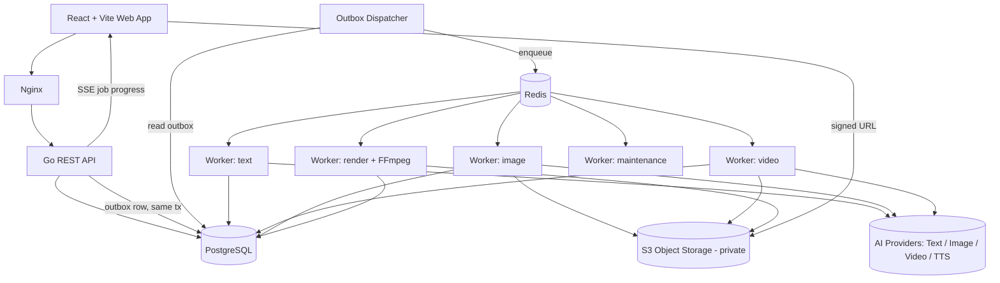
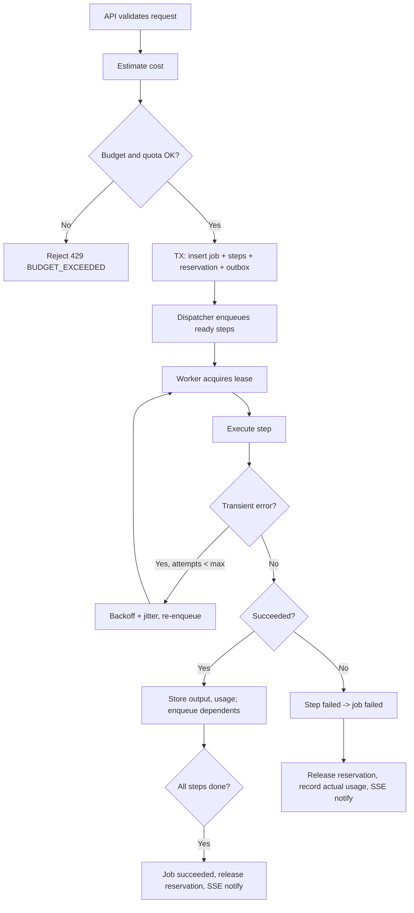
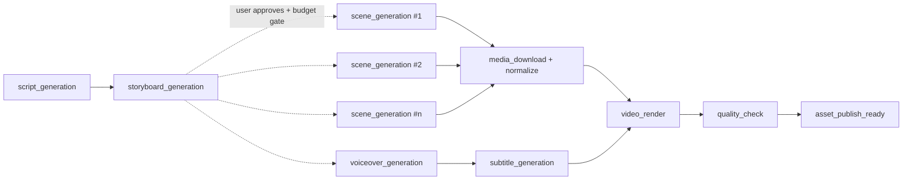

# SPEC-02 — Technical Architecture

## 1. Tổng quan



**Nguyên tắc**
1. Go **modular monolith**: 1 binary, 2 mode chạy: `api` và `worker --queues=text,image,...`. Scale worker độc lập.
2. PostgreSQL là nguồn sự thật. Redis chỉ là queue/lock/cache — mất Redis không mất job (dispatcher enqueue lại từ outbox/DB).
3. Handler nghiệp vụ **không gọi provider trực tiếp**; luôn qua `application` → `workflows` → `providers` interface.
4. File nằm ở S3 private; DB chỉ lưu metadata. FE tải/upload qua presigned URL.
5. Mọi tác vụ AI là async: API trả `202 Accepted` + `job_id`.

## 2. Tech stack

| Thành phần | Lựa chọn | Ghi chú |
|---|---|---|
| Frontend | React 18 + Vite + TypeScript | |
| UI | Tailwind CSS + shadcn/ui (Radix) | |
| State/data | TanStack Query, React Router, Zustand (UI state) | |
| Editor | TipTap | Rich text cho Content Studio |
| Backend | Go 1.23+, chi router | |
| DB access | sqlc + pgx v5 | Query type-safe |
| Migration | goose | Up/down |
| Queue | Redis 7 + asynq | Có retry, scheduled, unique task |
| Storage | S3 / MinIO (dev) | aws-sdk-go-v2 |
| Media | FFmpeg 6/7 + ffprobe | Trong image Docker của render worker |
| API spec | OpenAPI 3.1 (`api/openapi.yaml`) | Sinh TS client bằng `openapi-typescript` |
| Observability | slog JSON, Prometheus metrics, OpenTelemetry trace (P1) | |
| Deploy | Docker + Docker Compose + Nginx | K8s sau nếu cần (OQ-05) |
| Test | Go test + testcontainers; Vitest; Playwright E2E | |

## 3. Cấu trúc source

Dự án dùng **Clean Architecture** theo module nghiệp vụ cho cả backend và frontend. Cây thư mục, quy tắc phụ thuộc, code mẫu và cách kiểm tra kiến trúc tự động nằm ở [SPEC-06-code-structure.md](SPEC-06-code-structure.md).

Tóm tắt cấp repo:
```
/
├── api/        # Go: cmd/ (composition root) · internal/{shared/kernel, ports, modules/*, providers, platform}
├── web/        # React: src/{app, shared/{ui,api,lib,kernel}, modules/*/{domain,application,infrastructure,presentation}}
├── deploy/     # Dockerfile.api, Dockerfile.worker, Dockerfile.render, docker-compose, nginx.conf
└── docs/       # spec, plan, tasks
```

## 4. AI Provider Architecture

### 4.1. Interface (DTO nội bộ, không dùng JSON của vendor)

Các interface là **port** khai báo ở `api/internal/ports/ai.go`; adapter của từng vendor nằm ở `api/internal/providers/<vendor>/` (SPEC-06 §2.1).

```go
type Capabilities struct {
    AspectRatios    []string
    MaxDurationSec  int
    Resolutions     []string
    MaxVariants     int
    SupportsRefImg  bool
    Languages       []string
}

type TextProvider interface {
    Code() string
    Generate(ctx context.Context, req TextRequest) (TextResponse, error)
}

type TextRequest struct {
    Model        string
    System       string          // chỉ thị hệ thống, tách khỏi dữ liệu người dùng
    Messages     []Message       // brief, tài liệu => role=user, được bọc tag <data>
    JSONSchema   json.RawMessage // structured output
    MaxTokens    int
    Temperature  float32
}

type TextResponse struct {
    Content  string
    JSON     json.RawMessage
    Usage    Usage // input_tokens, output_tokens, cached_tokens
    Raw      json.RawMessage // lưu vào step.output_json đã lọc secret
}

type ImageProvider interface {
    Code() string
    Capabilities(model string) Capabilities
    Generate(ctx context.Context, req ImageRequest) (ImageResponse, error)
    Edit(ctx context.Context, req ImageEditRequest) (ImageResponse, error)
}

type VideoProvider interface {
    Code() string
    Capabilities(model string) Capabilities
    Submit(ctx context.Context, req VideoRequest) (VideoSubmission, error)
    GetStatus(ctx context.Context, providerJobID string) (VideoStatus, error)
    Cancel(ctx context.Context, providerJobID string) error
}

type VoiceProvider interface {
    Code() string
    Synthesize(ctx context.Context, req VoiceRequest) (VoiceResponse, error) // trả audio + word timings nếu có
}
```

### 4.2. Phân loại lỗi (adapter bắt buộc map)

```go
type ProviderError struct {
    Kind       ErrKind // Transient | RateLimited | InvalidRequest | ContentPolicy | Auth | Unknown
    Code       string  // mã của vendor
    RetryAfter time.Duration
    Message    string
}
```
- `Transient`, `RateLimited` → retry với backoff.
- `InvalidRequest`, `ContentPolicy`, `Auth` → fail ngay, không retry.

### 4.3. Registry & chọn model
- Bảng `ai_providers`, `ai_models` (capabilities, concurrency_limit, is_default per job_type).
- Registry load adapter theo `provider_code`; model chọn theo cấu hình mặc định hoặc request (nếu user có quyền).
- Mỗi job lưu `provider_code`, `model_code`, `prompt_template_id`, `prompt_version`, `brand_version_id`, `generation_params` → tái hiện được.

### 4.4. Contract test
Mỗi adapter có test chạy với HTTP recording (go-vcr) + 1 test live (tag `live`, chạy tay) để phát hiện vendor đổi API.

## 5. Job orchestration

### 5.1. Mô hình
- `ai_jobs`: 1 yêu cầu người dùng (VD "sinh 3 biến thể", "tạo video").
- `ai_job_steps`: các bước trong workflow (DAG). Job text/image thường 1–2 step; video nhiều step.
- `ai_job_events`: append-only log trạng thái.

### 5.2. Vòng đời job


Trạng thái job: `queued → running → succeeded | failed | cancelled`. Step có thêm `waiting_provider` (đã submit lên provider, đang poll), `skipped`.

### 5.3. Quy tắc bắt buộc
| Quy tắc | Triển khai |
|---|---|
| Transactional outbox | Insert job + `outbox_events` cùng transaction; dispatcher poll `outbox_events WHERE published_at IS NULL FOR UPDATE SKIP LOCKED` mỗi 1s |
| Idempotency | Header `Idempotency-Key` (bắt buộc với POST tạo job). Unique `(created_by, idempotency_key)`. Trùng key + cùng body hash → trả job cũ; khác body → 409 |
| Lease | Worker `UPDATE ai_job_steps SET lease_owner, lease_expires_at` (lease 2 phút, heartbeat 30s). Lease hết hạn → reconciler trả về queue |
| Retry | Chỉ lỗi transient; max 3 (text/image), 5 (video poll); backoff `min(2^n * 2s, 60s) + jitter 0–1s` |
| Dead-letter | Hết retry → step `failed`, job `failed`, `error_code`, alert |
| Concurrency | Semaphore Redis theo `provider:model` (`ai_models.concurrency_limit`) + theo user (mặc định 3 video job đồng thời) |
| Timeout | HTTP request 30s; text step 120s; image step 300s; video step tổng 30 phút (poll mỗi 10s); render 15 phút |
| Cancel | Đánh dấu `cancel_requested`; worker kiểm tra giữa các bước; với video gọi `provider.Cancel` nếu hỗ trợ. Không giả định provider dừng được → vẫn ghi usage |
| Reconciliation | Cron 5 phút: step `running` quá lease, step `waiting_provider` quá hạn → gọi `GetStatus`; provider xong nhưng DB chưa cập nhật → hoàn tất |
| Progress | SSE `GET /api/v1/jobs/{id}/events` (fallback polling `GET /jobs/{id}` 3s) |

### 5.4. Queues
| Queue | Tác vụ | Ưu tiên (asynq weight) | Concurrency mặc định / worker |
|---|---|---|---|
| `text` | viết, viết lại, plan, script, storyboard, prompt suggest | 6 | 10 |
| `image` | sinh ảnh, edit, biến thể | 3 | 4 |
| `video` | submit + poll scene clips | 1 | 4 |
| `render` | voice download, ffmpeg render, quality check | 3 | 2 (CPU-bound, container riêng) |
| `maintenance` | dọn file tạm, reconcile, alerts | 1 | 1 |

### 5.5. Workflow video (DAG)

- Script + storyboard là **job 1** (`video_storyboard`). Sau khi user duyệt storyboard và ngân sách → **job 2** (`video_production`).
- Regenerate 1 cảnh = job `video_scene_regenerate` (chỉ step scene + render + qc).
- Normalize: mọi clip → cùng fps (30), resolution theo preset, pixel format yuv420p, codec H.264, audio AAC 48kHz (thêm silent track nếu thiếu).

### 5.6. FFmpeg an toàn
- Gọi `exec.CommandContext("ffmpeg", args...)` với **mảng args**, không qua shell.
- Text phụ đề ghi ra file `.srt`/`.ass` rồi tham chiếu đường dẫn; không nhúng text người dùng vào filter string.
- Chạy trong container riêng, user không phải root, giới hạn CPU/RAM, thư mục tạm riêng mỗi job, xoá sau khi xong.

## 6. Quản lý chi phí

### 6.1. Đơn vị usage
| Loại | Đơn vị |
|---|---|
| Text | input_tokens, output_tokens, cached_tokens |
| Image | số ảnh × size × quality × model |
| Video | giây clip (hoặc số clip) × resolution × model |
| Voice | ký tự (hoặc giây) |
| Render | worker-seconds (nội bộ, chỉ thống kê) |

### 6.2. Bảng giá
`model_pricing(model_id, pricing_version, unit, unit_price, currency, effective_from, effective_to)`. Estimator lấy bản giá hiệu lực tại thời điểm tạo job; job lưu `pricing_version`.

### 6.3. Luồng ngân sách
1. **Preflight**: `cost.Estimate(jobSpec) → amount` (text: ước token từ độ dài prompt + max_tokens).
2. **Reserve** (trong transaction tạo job):
   ```sql
   SELECT ... FROM budgets WHERE scope IN (global, campaign) AND period = current FOR UPDATE;
   -- check: spent + reserved + estimate <= limit
   INSERT INTO budget_reservations(...);
   UPDATE budgets SET reserved_amount = reserved_amount + estimate;
   ```
3. **Per-job cap**: estimate > `per_job_limit` → 429 `JOB_BUDGET_EXCEEDED` trừ khi Lead truyền `budget_override=true` (ghi audit).
4. **Settle** khi job kết thúc: ghi `ai_usage_records` (cost_actual, `cost_source`), `reserved -= estimate`, `spent += actual`.
5. **Timeout nhưng provider có thể đã tính phí**: ghi usage `cost_source=estimated` với chi phí ước tính, đánh dấu `needs_reconciliation`.
6. **Alert**: 80% / 100% (cấu hình) → notification in-app + email Lead; 100% global → chặn job mới (trừ Admin override).

`cost_source`: `provider_reported` | `calculated` (usage × giá) | `estimated`. UI phải hiển thị rõ nhãn.

## 7. Bảo mật

| Mảng | Yêu cầu |
|---|---|
| AuthN | Session cookie HttpOnly+Secure+SameSite=Lax, session lưu DB (`sessions`), idle timeout 12h, absolute 7 ngày; password argon2id; lockout 5 lần/15 phút. SSO Google (P1, OQ-02) |
| CSRF | Double-submit token header `X-CSRF-Token` cho mọi method không phải GET |
| AuthZ | Middleware `RequirePermission(code)` + kiểm tra ownership ở application layer (chống IDOR) |
| Secrets | API key provider trong secret manager / env được quản lý; DB chỉ lưu `secret_ref`. Không trả FE, không log. Runbook rotate key |
| Logging | Redact header `Authorization`, `Cookie`, query `X-Amz-Signature`, field `api_key` |
| File upload | Presigned PUT có giới hạn content-length + content-type; sau upload gọi `POST /files/{id}/complete` → server sniff magic bytes, kiểm tra kích thước, dimension; sai → xóa |
| SSRF | Worker **không** tải URL do user nhập. Chỉ tải từ S3 nội bộ hoặc URL output của provider đã allowlist domain |
| Prompt injection | System instruction tách riêng; brief/tài liệu bọc trong `<user_data>`; output không được thực thi |
| Nội dung | Facts thương mại chỉ lấy từ Product; kiểm tra hậu sinh; review bắt buộc trước download (Creator) |
| Bản quyền | Lưu nguồn + license cho nhạc, ảnh tham chiếu (`asset_files.license_json`) |
| Audit | Bảng `audit_logs` append-only (REVOKE UPDATE/DELETE với app role) |
| Backup | pg_dump hằng ngày + WAL archive (nếu có); S3 versioning bật cho bucket assets; diễn tập restore trước go-live |

## 8. Observability

- Log JSON: `ts, level, msg, request_id, user_id, job_id, step_id, provider, model, duration_ms`.
- Metrics Prometheus:
  - `http_request_duration_seconds{route,status}`
  - `ai_job_total{type,status}`, `ai_step_duration_seconds{type,provider}`
  - `ai_provider_errors_total{provider,kind}`
  - `ai_cost_usd_total{provider,type,source}`
  - `queue_depth{queue}`, `outbox_lag_seconds`
- Alert: tỉ lệ job failed > 20%/15 phút, outbox lag > 60s, queue video > 50, ngân sách ≥ 80%.

## 9. Môi trường

| Env | Mục đích | Provider |
|---|---|---|
| local | Docker Compose: postgres, redis, minio, api, worker, render, web | Fake providers mặc định, real qua flag |
| staging | Test tích hợp, UAT | Real, ngân sách nhỏ riêng |
| production | Pilot & vận hành | Real |

Biến môi trường chính: `DATABASE_URL`, `REDIS_URL`, `S3_ENDPOINT`, `S3_BUCKET`, `SESSION_SECRET`, `PROVIDER_<CODE>_API_KEY` (hoặc `SECRET_MANAGER_*`), `APP_BASE_URL`, `SIGNED_URL_TTL=15m`.
