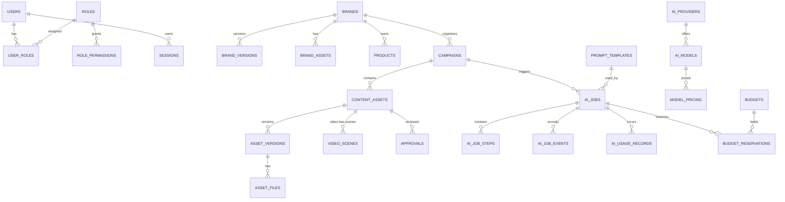

# SPEC-03 — Database Schema (PostgreSQL 16)

Quy ước:
- PK `UUID DEFAULT gen_random_uuid()`; thời gian `TIMESTAMPTZ`; dữ liệu provider/biến đổi dùng `JSONB`.
- Bảng nghiệp vụ có `created_at`, `updated_at` (trigger `set_updated_at`), `created_by` FK → `users`.
- Trạng thái dùng `TEXT + CHECK` (dễ migrate hơn ENUM).
- Tiền: `NUMERIC(14,6)` + `currency CHAR(3)`.
- Soft delete chỉ cho `brands`, `campaigns`, `content_assets` (`deleted_at`).

## 1. ERD



## 2. State machines

**Campaign**: `draft → in_progress → review → completed → archived` (cho phép `in_progress ↔ review`, mọi trạng thái → `archived`).

**Asset (review)** — tách biệt với trạng thái job:
```
draft ──submit──▶ pending_review ──approve──▶ approved
  ▲                     │
  └──── edit ◀── changes_requested ◀──request_changes
approved ──new revision──▶ draft   (phải duyệt lại)
```

**AI job**: `queued → running → succeeded | failed | cancelled`.
**Job step**: `pending → queued → running → (waiting_provider) → succeeded | failed | cancelled | skipped`.

**Video scene**: `draft → generating → ready | failed`; khi regenerate: `ready|failed → generating`.

## 3. Migration SQL

### 0001_init_extensions.sql
```sql
CREATE EXTENSION IF NOT EXISTS pgcrypto;
CREATE EXTENSION IF NOT EXISTS citext;
CREATE EXTENSION IF NOT EXISTS unaccent;

CREATE OR REPLACE FUNCTION set_updated_at() RETURNS trigger AS $$
BEGIN NEW.updated_at = now(); RETURN NEW; END;
$$ LANGUAGE plpgsql;
```

### 0002_users_rbac.sql
```sql
CREATE TABLE users (
    id UUID PRIMARY KEY DEFAULT gen_random_uuid(),
    email CITEXT NOT NULL UNIQUE,
    name TEXT NOT NULL,
    password_hash TEXT,                       -- NULL nếu dùng SSO
    status TEXT NOT NULL DEFAULT 'active' CHECK (status IN ('active','locked','disabled')),
    failed_login_count INT NOT NULL DEFAULT 0,
    locked_until TIMESTAMPTZ,
    last_login_at TIMESTAMPTZ,
    created_at TIMESTAMPTZ NOT NULL DEFAULT now(),
    updated_at TIMESTAMPTZ NOT NULL DEFAULT now()
);

CREATE TABLE roles (
    id UUID PRIMARY KEY DEFAULT gen_random_uuid(),
    code TEXT NOT NULL UNIQUE,                -- admin, marketing_lead, content_creator, reviewer
    name TEXT NOT NULL
);

CREATE TABLE role_permissions (
    role_id UUID NOT NULL REFERENCES roles(id) ON DELETE CASCADE,
    permission TEXT NOT NULL,                 -- brand.manage, generate.run, ...
    PRIMARY KEY (role_id, permission)
);

CREATE TABLE user_roles (
    user_id UUID NOT NULL REFERENCES users(id) ON DELETE CASCADE,
    role_id UUID NOT NULL REFERENCES roles(id),
    PRIMARY KEY (user_id, role_id)
);

CREATE TABLE sessions (
    id UUID PRIMARY KEY DEFAULT gen_random_uuid(),
    user_id UUID NOT NULL REFERENCES users(id) ON DELETE CASCADE,
    token_hash BYTEA NOT NULL UNIQUE,         -- sha256 của token cookie
    csrf_token TEXT NOT NULL,
    ip INET,
    user_agent TEXT,
    last_seen_at TIMESTAMPTZ NOT NULL DEFAULT now(),
    expires_at TIMESTAMPTZ NOT NULL,
    revoked_at TIMESTAMPTZ,
    created_at TIMESTAMPTZ NOT NULL DEFAULT now()
);
CREATE INDEX idx_sessions_user ON sessions (user_id) WHERE revoked_at IS NULL;

CREATE TRIGGER trg_users_updated BEFORE UPDATE ON users FOR EACH ROW EXECUTE FUNCTION set_updated_at();
```

### 0003_files.sql
```sql
CREATE TABLE asset_files (
    id UUID PRIMARY KEY DEFAULT gen_random_uuid(),
    storage_key TEXT NOT NULL UNIQUE,         -- s3 key, không chứa thông tin nhạy cảm
    original_name TEXT,
    mime_type TEXT NOT NULL,
    size_bytes BIGINT NOT NULL CHECK (size_bytes >= 0),
    checksum_sha256 TEXT,
    width INT, height INT, duration_ms INT,
    kind TEXT NOT NULL CHECK (kind IN ('image','video','audio','subtitle','document','other')),
    upload_status TEXT NOT NULL DEFAULT 'pending' CHECK (upload_status IN ('pending','ready','rejected')),
    source TEXT NOT NULL CHECK (source IN ('upload','generated','rendered')),
    parent_file_id UUID REFERENCES asset_files(id), -- biến thể/edit từ file nào
    license_json JSONB NOT NULL DEFAULT '{}',  -- nguồn, license, hạn dùng
    metadata JSONB NOT NULL DEFAULT '{}',
    created_by UUID REFERENCES users(id),
    created_at TIMESTAMPTZ NOT NULL DEFAULT now()
);
CREATE INDEX idx_files_status_created ON asset_files (upload_status, created_at);
```

### 0004_brands_products.sql
```sql
CREATE TABLE brands (
    id UUID PRIMARY KEY DEFAULT gen_random_uuid(),
    name TEXT NOT NULL,
    current_version_id UUID,                  -- FK thêm sau khi tạo brand_versions
    created_by UUID REFERENCES users(id),
    created_at TIMESTAMPTZ NOT NULL DEFAULT now(),
    updated_at TIMESTAMPTZ NOT NULL DEFAULT now(),
    deleted_at TIMESTAMPTZ
);
CREATE UNIQUE INDEX uq_brands_name ON brands (lower(name)) WHERE deleted_at IS NULL;

-- profile: {description, colors[], typography{}, tone_of_voice[], preferred_words[], forbidden_words[], default_ctas[], audience_personas[], notes}
CREATE TABLE brand_versions (
    id UUID PRIMARY KEY DEFAULT gen_random_uuid(),
    brand_id UUID NOT NULL REFERENCES brands(id),
    version_no INT NOT NULL,
    profile JSONB NOT NULL,
    created_by UUID REFERENCES users(id),
    created_at TIMESTAMPTZ NOT NULL DEFAULT now(),
    UNIQUE (brand_id, version_no)
);
ALTER TABLE brands ADD CONSTRAINT fk_brands_current_version
    FOREIGN KEY (current_version_id) REFERENCES brand_versions(id);

CREATE TABLE brand_assets (
    id UUID PRIMARY KEY DEFAULT gen_random_uuid(),
    brand_id UUID NOT NULL REFERENCES brands(id),
    file_id UUID NOT NULL REFERENCES asset_files(id),
    asset_type TEXT NOT NULL CHECK (asset_type IN ('logo','reference_image','font','document','sample_content','music')),
    label TEXT,
    created_by UUID REFERENCES users(id),
    created_at TIMESTAMPTZ NOT NULL DEFAULT now()
);
CREATE INDEX idx_brand_assets_brand ON brand_assets (brand_id, asset_type);

-- facts: {usp[], price{amount,currency,note}, offers[{text,valid_from,valid_to}], policies[], proof[{type,text,source,verified}]}
CREATE TABLE products (
    id UUID PRIMARY KEY DEFAULT gen_random_uuid(),
    brand_id UUID NOT NULL REFERENCES brands(id),
    name TEXT NOT NULL,
    description TEXT,
    facts JSONB NOT NULL DEFAULT '{}',
    status TEXT NOT NULL DEFAULT 'active' CHECK (status IN ('active','archived')),
    created_by UUID REFERENCES users(id),
    created_at TIMESTAMPTZ NOT NULL DEFAULT now(),
    updated_at TIMESTAMPTZ NOT NULL DEFAULT now()
);
CREATE INDEX idx_products_brand ON products (brand_id) WHERE status = 'active';

CREATE TRIGGER trg_brands_updated BEFORE UPDATE ON brands FOR EACH ROW EXECUTE FUNCTION set_updated_at();
CREATE TRIGGER trg_products_updated BEFORE UPDATE ON products FOR EACH ROW EXECUTE FUNCTION set_updated_at();
```

### 0005_campaigns.sql
```sql
-- brief: {product_ids[], target_audience, key_message, verified_offer, channels[], formats[{type,count}], deadline, notes}
CREATE TABLE campaigns (
    id UUID PRIMARY KEY DEFAULT gen_random_uuid(),
    brand_id UUID NOT NULL REFERENCES brands(id),
    name TEXT NOT NULL,
    goal TEXT NOT NULL CHECK (goal IN ('awareness','engagement','lead','conversion')),
    brief JSONB NOT NULL DEFAULT '{}',
    content_plan JSONB,                       -- plan AI đề xuất đã được user duyệt
    status TEXT NOT NULL DEFAULT 'draft'
        CHECK (status IN ('draft','in_progress','review','completed','archived')),
    start_date DATE, end_date DATE,
    created_by UUID NOT NULL REFERENCES users(id),
    created_at TIMESTAMPTZ NOT NULL DEFAULT now(),
    updated_at TIMESTAMPTZ NOT NULL DEFAULT now(),
    deleted_at TIMESTAMPTZ
);
CREATE INDEX idx_campaigns_brand_created ON campaigns (brand_id, created_at DESC);
CREATE INDEX idx_campaigns_status ON campaigns (status) WHERE deleted_at IS NULL;

CREATE TABLE campaign_members (
    campaign_id UUID NOT NULL REFERENCES campaigns(id) ON DELETE CASCADE,
    user_id UUID NOT NULL REFERENCES users(id),
    PRIMARY KEY (campaign_id, user_id)
);

CREATE TRIGGER trg_campaigns_updated BEFORE UPDATE ON campaigns FOR EACH ROW EXECUTE FUNCTION set_updated_at();
```

### 0006_assets.sql
```sql
CREATE TABLE content_assets (
    id UUID PRIMARY KEY DEFAULT gen_random_uuid(),
    campaign_id UUID REFERENCES campaigns(id),
    brand_id UUID NOT NULL REFERENCES brands(id),
    asset_type TEXT NOT NULL CHECK (asset_type IN ('content','image','video')),
    subtype TEXT,                              -- facebook_post, tiktok_script, poster, social_vertical...
    title TEXT NOT NULL,
    status TEXT NOT NULL DEFAULT 'draft'
        CHECK (status IN ('draft','pending_review','changes_requested','approved','archived')),
    current_version_id UUID,
    source_asset_id UUID REFERENCES content_assets(id), -- chuyển đổi từ asset nào
    tags TEXT[] NOT NULL DEFAULT '{}',
    search_tsv TSVECTOR,                       -- cập nhật khi tạo version
    created_by UUID NOT NULL REFERENCES users(id),
    created_at TIMESTAMPTZ NOT NULL DEFAULT now(),
    updated_at TIMESTAMPTZ NOT NULL DEFAULT now(),
    deleted_at TIMESTAMPTZ
);
CREATE INDEX idx_assets_campaign_status ON content_assets (campaign_id, status);
CREATE INDEX idx_assets_type_created ON content_assets (asset_type, created_at DESC);
CREATE INDEX idx_assets_tags ON content_assets USING GIN (tags);
CREATE INDEX idx_assets_search ON content_assets USING GIN (search_tsv);

-- content_json theo asset_type:
--  content: {title, hook, body_html, body_text, cta, hashtags[], platform, warnings[]}
--  image:   {prompt, preset, aspect_ratio, file_ids[]}
--  video:   {prompt, preset, aspect_ratio, script, scene_ids[], final_file_id, subtitle_file_id}
CREATE TABLE asset_versions (
    id UUID PRIMARY KEY DEFAULT gen_random_uuid(),
    asset_id UUID NOT NULL REFERENCES content_assets(id),
    version_no INT NOT NULL,
    content_json JSONB NOT NULL,
    change_note TEXT,
    generated_by_job_id UUID,                 -- FK thêm ở 0008
    created_by UUID NOT NULL REFERENCES users(id),
    created_at TIMESTAMPTZ NOT NULL DEFAULT now(),
    UNIQUE (asset_id, version_no)
);
ALTER TABLE content_assets ADD CONSTRAINT fk_assets_current_version
    FOREIGN KEY (current_version_id) REFERENCES asset_versions(id);

CREATE TABLE asset_version_files (
    version_id UUID NOT NULL REFERENCES asset_versions(id),
    file_id UUID NOT NULL REFERENCES asset_files(id),
    role TEXT NOT NULL CHECK (role IN ('primary','variant','thumbnail','subtitle','audio','preview')),
    sort_order INT NOT NULL DEFAULT 0,
    PRIMARY KEY (version_id, file_id)
);

CREATE TABLE video_scenes (
    id UUID PRIMARY KEY DEFAULT gen_random_uuid(),
    asset_id UUID NOT NULL REFERENCES content_assets(id),
    sequence_no INT NOT NULL,
    duration_ms INT NOT NULL CHECK (duration_ms > 0),
    visual_prompt TEXT NOT NULL,
    narration TEXT,
    subtitle_text TEXT,
    source_file_id UUID REFERENCES asset_files(id),   -- ảnh đầu vào (image-to-video)
    clip_file_id UUID REFERENCES asset_files(id),     -- clip đã sinh + normalize
    status TEXT NOT NULL DEFAULT 'draft' CHECK (status IN ('draft','generating','ready','failed')),
    attempt_count INT NOT NULL DEFAULT 0,
    last_error TEXT,
    created_at TIMESTAMPTZ NOT NULL DEFAULT now(),
    updated_at TIMESTAMPTZ NOT NULL DEFAULT now(),
    UNIQUE (asset_id, sequence_no) DEFERRABLE INITIALLY DEFERRED
);

CREATE TABLE approvals (
    id UUID PRIMARY KEY DEFAULT gen_random_uuid(),
    asset_id UUID NOT NULL REFERENCES content_assets(id),
    version_id UUID NOT NULL REFERENCES asset_versions(id),
    reviewer_id UUID NOT NULL REFERENCES users(id),
    decision TEXT NOT NULL CHECK (decision IN ('submitted','approved','changes_requested')),
    comment TEXT,
    checklist JSONB NOT NULL DEFAULT '{}',    -- VD {"typography_checked": true}
    created_at TIMESTAMPTZ NOT NULL DEFAULT now()
);
CREATE INDEX idx_approvals_asset ON approvals (asset_id, created_at DESC);

CREATE TRIGGER trg_assets_updated BEFORE UPDATE ON content_assets FOR EACH ROW EXECUTE FUNCTION set_updated_at();
CREATE TRIGGER trg_scenes_updated BEFORE UPDATE ON video_scenes FOR EACH ROW EXECUTE FUNCTION set_updated_at();
```

### 0007_ai_config.sql
```sql
CREATE TABLE ai_providers (
    id UUID PRIMARY KEY DEFAULT gen_random_uuid(),
    code TEXT NOT NULL UNIQUE,                -- openai, <video_vendor>, <tts_vendor>, fake
    name TEXT NOT NULL,
    kind TEXT[] NOT NULL,                     -- {text,image,video,voice}
    status TEXT NOT NULL DEFAULT 'active' CHECK (status IN ('active','disabled')),
    secret_ref TEXT NOT NULL,                 -- tên secret trong secret manager/env, KHÔNG phải key
    config_json JSONB NOT NULL DEFAULT '{}',  -- base_url, region, timeout... không chứa secret
    created_at TIMESTAMPTZ NOT NULL DEFAULT now(),
    updated_at TIMESTAMPTZ NOT NULL DEFAULT now()
);

CREATE TABLE ai_models (
    id UUID PRIMARY KEY DEFAULT gen_random_uuid(),
    provider_id UUID NOT NULL REFERENCES ai_providers(id),
    model_code TEXT NOT NULL,
    kind TEXT NOT NULL CHECK (kind IN ('text','image','video','voice')),
    capabilities JSONB NOT NULL DEFAULT '{}', -- aspect_ratios, max_duration_sec, resolutions, max_variants, supports_ref_image, languages
    concurrency_limit INT NOT NULL DEFAULT 2,
    is_default BOOLEAN NOT NULL DEFAULT false,
    status TEXT NOT NULL DEFAULT 'active' CHECK (status IN ('active','disabled')),
    UNIQUE (provider_id, model_code)
);
CREATE UNIQUE INDEX uq_models_default_kind ON ai_models (kind) WHERE is_default AND status = 'active';

CREATE TABLE model_pricing (
    id UUID PRIMARY KEY DEFAULT gen_random_uuid(),
    model_id UUID NOT NULL REFERENCES ai_models(id),
    pricing_version TEXT NOT NULL,
    unit TEXT NOT NULL,                       -- input_token, output_token, image_1024_standard, video_second_1080p, char
    unit_price NUMERIC(14,8) NOT NULL,
    currency CHAR(3) NOT NULL DEFAULT 'USD',
    effective_from TIMESTAMPTZ NOT NULL,
    effective_to TIMESTAMPTZ,
    UNIQUE (model_id, pricing_version, unit)
);

CREATE TABLE prompt_templates (
    id UUID PRIMARY KEY DEFAULT gen_random_uuid(),
    code TEXT NOT NULL,                       -- content.facebook_post, image.prompt_suggest, video.storyboard
    version INT NOT NULL,
    system_prompt TEXT NOT NULL,
    user_template TEXT NOT NULL,
    output_schema JSONB,
    status TEXT NOT NULL DEFAULT 'active' CHECK (status IN ('draft','active','retired')),
    created_by UUID REFERENCES users(id),
    created_at TIMESTAMPTZ NOT NULL DEFAULT now(),
    UNIQUE (code, version)
);
```

### 0008_jobs.sql
```sql
CREATE TABLE ai_jobs (
    id UUID PRIMARY KEY DEFAULT gen_random_uuid(),
    job_type TEXT NOT NULL CHECK (job_type IN (
        'content_generation','content_rewrite','content_transform','content_plan',
        'image_generation','image_edit','image_prompt_suggest',
        'video_storyboard','video_production','video_scene_regenerate','video_render')),
    status TEXT NOT NULL DEFAULT 'queued'
        CHECK (status IN ('queued','running','succeeded','failed','cancelled')),
    campaign_id UUID REFERENCES campaigns(id),
    asset_id UUID REFERENCES content_assets(id),
    brand_version_id UUID REFERENCES brand_versions(id),
    prompt_template_id UUID REFERENCES prompt_templates(id),
    provider_code TEXT,
    model_code TEXT,
    request_json JSONB NOT NULL,              -- tham số đã validate
    result_json JSONB,
    idempotency_key TEXT,
    request_hash TEXT,
    cost_estimate NUMERIC(14,6),
    cost_actual NUMERIC(14,6),
    cost_source TEXT CHECK (cost_source IN ('provider_reported','calculated','estimated')),
    currency CHAR(3) NOT NULL DEFAULT 'USD',
    pricing_version TEXT,
    budget_override_by UUID REFERENCES users(id),
    cancel_requested BOOLEAN NOT NULL DEFAULT false,
    needs_reconciliation BOOLEAN NOT NULL DEFAULT false,
    progress SMALLINT NOT NULL DEFAULT 0 CHECK (progress BETWEEN 0 AND 100),
    error_code TEXT,
    error_message TEXT,
    created_by UUID NOT NULL REFERENCES users(id),
    started_at TIMESTAMPTZ,
    finished_at TIMESTAMPTZ,
    created_at TIMESTAMPTZ NOT NULL DEFAULT now(),
    UNIQUE (created_by, idempotency_key)
);
CREATE INDEX idx_jobs_status_created ON ai_jobs (status, created_at);
CREATE INDEX idx_jobs_campaign ON ai_jobs (campaign_id, created_at DESC);
CREATE INDEX idx_jobs_asset ON ai_jobs (asset_id);
CREATE INDEX idx_jobs_reconcile ON ai_jobs (id) WHERE needs_reconciliation;

ALTER TABLE asset_versions ADD CONSTRAINT fk_versions_job
    FOREIGN KEY (generated_by_job_id) REFERENCES ai_jobs(id);

CREATE TABLE ai_job_steps (
    id UUID PRIMARY KEY DEFAULT gen_random_uuid(),
    job_id UUID NOT NULL REFERENCES ai_jobs(id) ON DELETE CASCADE,
    step_type TEXT NOT NULL,                  -- script_generation, scene_generation, video_render...
    step_key TEXT NOT NULL,                   -- duy nhất trong job, VD scene_generation:3
    depends_on TEXT[] NOT NULL DEFAULT '{}',  -- danh sách step_key
    scene_id UUID REFERENCES video_scenes(id),
    status TEXT NOT NULL DEFAULT 'pending' CHECK (status IN
        ('pending','queued','running','waiting_provider','succeeded','failed','cancelled','skipped')),
    input_json JSONB NOT NULL DEFAULT '{}',
    output_json JSONB,
    provider_job_id TEXT,
    attempt_count INT NOT NULL DEFAULT 0,
    max_attempts INT NOT NULL DEFAULT 3,
    next_attempt_at TIMESTAMPTZ,
    lease_owner TEXT,
    lease_expires_at TIMESTAMPTZ,
    error_kind TEXT,
    error_message TEXT,
    started_at TIMESTAMPTZ,
    finished_at TIMESTAMPTZ,
    created_at TIMESTAMPTZ NOT NULL DEFAULT now(),
    UNIQUE (job_id, step_key)
);
CREATE INDEX idx_steps_lease ON ai_job_steps (lease_expires_at) WHERE status IN ('running','waiting_provider');

CREATE TABLE ai_job_events (
    id BIGSERIAL PRIMARY KEY,
    job_id UUID NOT NULL REFERENCES ai_jobs(id) ON DELETE CASCADE,
    step_id UUID REFERENCES ai_job_steps(id),
    event_type TEXT NOT NULL,                 -- status_changed, progress, retry_scheduled, provider_error...
    payload JSONB NOT NULL DEFAULT '{}',
    created_at TIMESTAMPTZ NOT NULL DEFAULT now()
);
CREATE INDEX idx_job_events_job ON ai_job_events (job_id, id);

CREATE TABLE outbox_events (
    id BIGSERIAL PRIMARY KEY,
    topic TEXT NOT NULL,                      -- queue name
    payload JSONB NOT NULL,                   -- {job_id, step_id}
    available_at TIMESTAMPTZ NOT NULL DEFAULT now(),
    published_at TIMESTAMPTZ,
    created_at TIMESTAMPTZ NOT NULL DEFAULT now()
);
CREATE INDEX idx_outbox_unpublished ON outbox_events (available_at) WHERE published_at IS NULL;
```

### 0009_usage_budget.sql
```sql
CREATE TABLE ai_usage_records (
    id UUID PRIMARY KEY DEFAULT gen_random_uuid(),
    job_id UUID NOT NULL REFERENCES ai_jobs(id),
    step_id UUID REFERENCES ai_job_steps(id),
    campaign_id UUID REFERENCES campaigns(id),
    user_id UUID NOT NULL REFERENCES users(id),
    provider_code TEXT NOT NULL,
    model_code TEXT NOT NULL,
    usage_json JSONB NOT NULL,                -- {input_tokens, output_tokens} | {images, size, quality} | {seconds, resolution} | {chars}
    cost_amount NUMERIC(14,6) NOT NULL,
    cost_source TEXT NOT NULL CHECK (cost_source IN ('provider_reported','calculated','estimated')),
    currency CHAR(3) NOT NULL DEFAULT 'USD',
    pricing_version TEXT,
    occurred_at TIMESTAMPTZ NOT NULL DEFAULT now()
);
CREATE INDEX idx_usage_occurred ON ai_usage_records (occurred_at);
CREATE INDEX idx_usage_campaign ON ai_usage_records (campaign_id, occurred_at);

CREATE TABLE budgets (
    id UUID PRIMARY KEY DEFAULT gen_random_uuid(),
    scope TEXT NOT NULL CHECK (scope IN ('global','campaign')),
    campaign_id UUID REFERENCES campaigns(id),
    period_start DATE NOT NULL,               -- global: đầu tháng; campaign: start campaign
    period_end DATE NOT NULL,
    limit_amount NUMERIC(14,6) NOT NULL CHECK (limit_amount >= 0),
    reserved_amount NUMERIC(14,6) NOT NULL DEFAULT 0,
    spent_amount NUMERIC(14,6) NOT NULL DEFAULT 0,
    currency CHAR(3) NOT NULL DEFAULT 'USD',
    alert_thresholds INT[] NOT NULL DEFAULT '{80,100}',
    alerts_sent INT[] NOT NULL DEFAULT '{}',
    hard_stop BOOLEAN NOT NULL DEFAULT true,
    updated_at TIMESTAMPTZ NOT NULL DEFAULT now(),
    CHECK ((scope = 'global' AND campaign_id IS NULL) OR (scope = 'campaign' AND campaign_id IS NOT NULL))
);
CREATE UNIQUE INDEX uq_budget_global_period ON budgets (period_start) WHERE scope = 'global';
CREATE UNIQUE INDEX uq_budget_campaign ON budgets (campaign_id) WHERE scope = 'campaign';

CREATE TABLE budget_settings (
    id SMALLINT PRIMARY KEY DEFAULT 1 CHECK (id = 1),
    per_job_limit_text NUMERIC(14,6) NOT NULL,
    per_job_limit_image NUMERIC(14,6) NOT NULL,
    per_job_limit_video NUMERIC(14,6) NOT NULL,
    max_concurrent_video_jobs_per_user INT NOT NULL DEFAULT 3,
    currency CHAR(3) NOT NULL DEFAULT 'USD',
    updated_by UUID REFERENCES users(id),
    updated_at TIMESTAMPTZ NOT NULL DEFAULT now()
);

CREATE TABLE budget_reservations (
    id UUID PRIMARY KEY DEFAULT gen_random_uuid(),
    budget_id UUID NOT NULL REFERENCES budgets(id),
    job_id UUID NOT NULL REFERENCES ai_jobs(id),
    amount NUMERIC(14,6) NOT NULL,
    status TEXT NOT NULL DEFAULT 'held' CHECK (status IN ('held','settled','released')),
    created_at TIMESTAMPTZ NOT NULL DEFAULT now(),
    settled_at TIMESTAMPTZ,
    UNIQUE (budget_id, job_id)
);
```

### 0010_audit_notifications.sql
```sql
CREATE TABLE audit_logs (
    id BIGSERIAL PRIMARY KEY,
    actor_id UUID REFERENCES users(id),
    action TEXT NOT NULL,                     -- budget.update, provider.update, role.assign, asset.approve, asset.download, asset.delete
    resource_type TEXT NOT NULL,
    resource_id TEXT NOT NULL,
    before_json JSONB,
    after_json JSONB,
    ip INET,
    request_id TEXT,
    created_at TIMESTAMPTZ NOT NULL DEFAULT now()
);
CREATE INDEX idx_audit_resource ON audit_logs (resource_type, resource_id, created_at DESC);
CREATE INDEX idx_audit_actor ON audit_logs (actor_id, created_at DESC);
-- Append-only: app role chỉ có INSERT, SELECT
-- REVOKE UPDATE, DELETE ON audit_logs FROM app_user;

CREATE TABLE notifications (
    id UUID PRIMARY KEY DEFAULT gen_random_uuid(),
    user_id UUID NOT NULL REFERENCES users(id),
    type TEXT NOT NULL,                       -- job_failed, review_requested, changes_requested, budget_alert
    payload JSONB NOT NULL DEFAULT '{}',
    read_at TIMESTAMPTZ,
    created_at TIMESTAMPTZ NOT NULL DEFAULT now()
);
CREATE INDEX idx_notifications_user_unread ON notifications (user_id, created_at DESC) WHERE read_at IS NULL;
```

### 0011_seed.sql (dữ liệu khởi tạo)
```sql
INSERT INTO roles (code, name) VALUES
 ('admin','Admin'), ('marketing_lead','Marketing Lead'),
 ('content_creator','Content Creator'), ('reviewer','Reviewer');

-- role_permissions theo bảng RBAC ở SPEC-01 §2
-- budget_settings 1 dòng với giá trị từ OQ-03
-- ai_providers 'fake' + model fake cho local/test
```

## 4. Ghi chú truy vấn quan trọng

- **Search asset**: `search_tsv = to_tsvector('simple', unaccent(title || ' ' || body_text))` cập nhật khi tạo version (`unaccent` cần extension; dùng config `simple` vì tiếng Việt). Lọc thêm bằng index `(asset_type, created_at)`.
- **Reservation** chạy trong transaction tạo job, khóa dòng `budgets` theo thứ tự cố định (global trước, campaign sau) để tránh deadlock.
- **Dispatcher**: `SELECT id, topic, payload FROM outbox_events WHERE published_at IS NULL AND available_at <= now() ORDER BY id LIMIT 100 FOR UPDATE SKIP LOCKED`.
- **Version number**: `SELECT coalesce(max(version_no),0)+1 ... FOR UPDATE` trên dòng `content_assets` cha.
